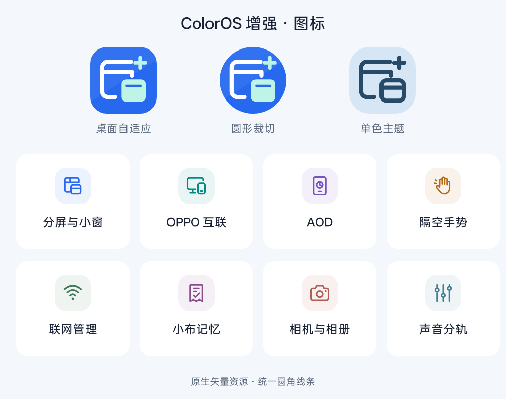

# 2.1.4 图标更新

本版只调整应用图标、主页入口图标及其展示代码，应用身份、签名、配置键和底层适配器源文件保持一致。版本为 2.1.4／20。

应用图标采用蓝色窗口与薄荷色增强标记，提供自适应前景、背景和单色资源，主页标题使用同一图形。主页 1–8 的数字徽标替换为功能图标，使用统一线宽、圆角、浅色背景和原有分组色；入口右侧箭头也改为矢量。

| 入口 | 图形 |
| --- | --- |
| 分屏与小窗 | 叠放窗口 |
| OPPO 互联 | 显示器与手机 |
| AOD | 息屏手机与时钟 |
| 隔空手势 | 手掌与感应线 |
| 联网管理 | 无线网络信号 |
| 小布记忆 | 账单与勾选 |
| 相机与相册 | 相机 |
| 声音分轨 | 三路调节器 |

装饰图标不重复参与无障碍朗读，入口继续使用功能名称、说明和按钮语义。资源使用 Android VectorDrawable，无需字体符号或位图缩放。

Release 构建通过，Lint 为 0 错误、31 警告。已安装到 PHY110，检查主页上下部分、8 个入口跳转以及原生资源绘制；预览包含系统自适应遮罩、圆形裁切和单色绘制。没有切换用户桌面主题，不能将单色预览等同于所有桌面主题的端到端验证。

配置、作用域、其他模块状态、核心进程、开机标识及屏幕超时均与本轮基线一致，临时预览工具与设备临时文件已移除。首次独立渲染工具因字体尚未初始化退出，随后在正常应用上下文中完成渲染；该工具异常与模块应用分开记录，未将崩溃缓冲区描述为全空。

本次未改动底层适配器，未重复功能矩阵或单元测试。2.1.3 的 147 项测试与实机功能证据保留为历史基线。图标及界面已生效；本轮没有重启手机，常驻宿主中的版本元数据会在正常重启后统一。脱敏记录见 [validation.json](evidence/icons-2.1.4/validation.json)。
